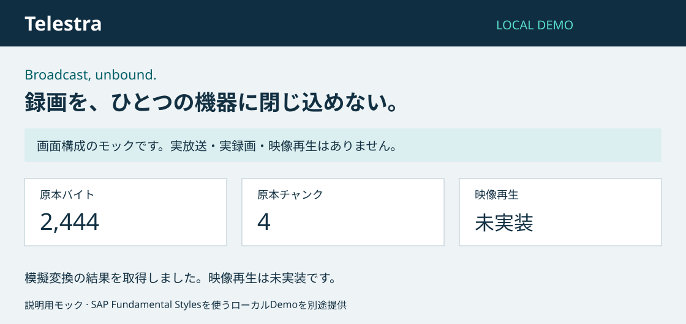
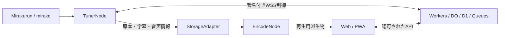

<p align="center"></p>

<h1 align="center">Telestra</h1>
<p align="center"><strong>Broadcast, unbound.</strong><br />録画を、ひとつの機器に閉じ込めない。</p>
<p align="center">
  <a href="https://github.com/Azsoft-jp/telestra/actions/workflows/ci.yml"></a>
  <a href="LICENSE"></a>
</p>

Telestraは、チューナー、変換、ストレージ、Webを分けて開発する、Cloudflare-firstのテレビ視聴・録画基盤です。TS原本と字幕・音声情報を保持し、視聴用の変換や保存先を選べる構成を目指します。

**現在は開発中です。** 実録画・映像再生を提供する完成アプリではありません。チューナー不要のDemoとMock、ローカルの認証・WSS契約試験を実行できます。安定版Releaseはまだありません。Releaseバッジは実際のリリース後に追加します。



## いま使えるもの

| 区分 | 内容 |
| --- | --- |
| 実装済み・Mock | ローカルDemo UI、原本のチャンク化・hash照合・再構築、Fake Storage、模擬変換、状態表示 |
| 開発中 | Nodeの登録・資格発行/更新/失効、署名付きWSS、D1の予約intentと合成録画台帳。ローカル試験の範囲 |
| 計画中 | Mirakurun/mirakcからの実受信、EPG、予約録画、ライブ・録画視聴、実Encode、ARIB字幕・DRCS・ルビ |
| 計画中 | PWA、端末保存、オフライン視聴、R2/S3、実環境IaC、二次静的配信と復旧演習 |

[実装状況と検証結果](docs/phase-01-progress.md)と[受け入れ試験ID](docs/08-acceptance.md)で、確認済みと未確認を区別しています。合成fixtureの成功は実Codecや字幕再現の証明ではありません。

## Quick Start

Node.js 24、Go 1.26.10、Python 3.11以降が必要です。チューナー・GPU・クラウドアカウントは不要です。初回の依存取得に通信を使います。

```sh
git clone https://github.com/Azsoft-jp/telestra.git
cd telestra
npm ci --ignore-scripts --no-audit --no-fund
go mod download
npm run telestra -- demo
```

http://127.0.0.1:5173を開きます。合成データ2,444バイト・4チャンク・映像再生は未実装と表示します。終了はCtrl+Cです。検査は`npm run check`、JSONでのMock実行は`npm run telestra -- mock`を使います。

[はじめての操作](docs/getting-started.md)・[導入4モード](docs/installation.md)・[設定](docs/configuration.md)・[トラブルシューティング](docs/troubleshooting.md)。Demo以外の導入は計画中です。検証条件と結果は[公開整備レポート](docs/public-readiness-report.md)を参照してください。

## 分けて、保存し、回復する



図は目標構成です。TunerNodeは軽量に保ち、FFmpegや独自EIT解析器を含めません。EncodeNodeは分離し、事後エンコードから検証します。TS原本チャンクとHLSセグメントを分け、変換不可でも原本保存を独立して続ける設計です。

[構成と責任境界](docs/architecture/overview.md)・[設計原則](docs/architecture/principles.md)・[ADR](docs/architecture/decisions/README.md)。Cloudflareを第一実装とし、Storage等の拡張は実装差を検証して追加します。

## 安全性と冗長化の限界

WSSは型付き制御専用です。署名、認可、期限、世代、サイズを検証し、汎用Shellや任意URL取得を設けません。回線分断による重複録画はattempt別に保持し、物理的なexactly-onceを保証しません。

dual-staticは同じWeb成果物をCloudflare Workers Static Assetsと独立した二次配信元へ置く設計です。API・認証・DBを含む全面冗長化ではありません。別originでは再ログインが必要で、Service Worker・OPFS・IndexedDB・Cookieは共有されません。実環境の配信・復旧は未検証です。

[セキュリティ報告](SECURITY.md)・[IaCと配信の所有権](docs/07-iac-and-frontend-dr.md)・[ストレージ容量と費用の考え方](docs/12-storage-capacity.md)。Demoと宅内のチューナー管理APIを外部公開しないでください。

## 開発に参加する

[Contributing](CONTRIBUTING.md)・[行動規範](CODE_OF_CONDUCT.md)・[サポート](SUPPORT.md)・[変更履歴](CHANGELOG.md)・[リリース/互換性方針](docs/governance/releases.md)。追加指示は[PROJECT-01](tasks/PROJECT-01-PUBLIC-READINESS.md)で追跡し、本体の段階実装を維持します。

本体と独自アセットは[MIT License](LICENSE)です。依存物には別の条件があります。[第三者一覧](THIRD_PARTY_NOTICES.md)と[アセットの出所](docs/governance/assets.md)を確認してください。

Mirakurun、mirakc、SAP Fundamental Styles、Cloudflareの開発ツール、Go・TypeScriptと各依存プロジェクトに感謝します。KonomiTVは設計検討の参考であり、コードやアセットの移植・互換実装を主張しません。各名称への言及は提携や認定を意味しません。
