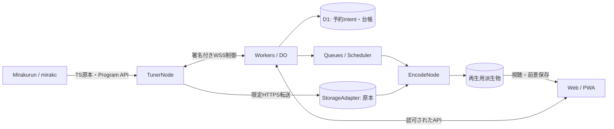

# Telestraの構成

Telestraは、チューナー、変換、保存、Webを分けて開発するテレビ視聴・録画基盤である。Cloudflareを第一実装とし、対応していないクラウドの機能差を共通APIの成功応答で隠さない。

図は目標構成である。現在はMockの原本保存・再構築と、ローカルWorker/D1/DO・GoのWSSを検証した段階にある。実Storage、Queuesによる割当、実Encode、実視聴は完成していない。

| 境界 | 責務 | 現在の実装 |
| --- | --- | --- |
| TunerNode | 既存API、TS受信・スプール・転送、確定予約、制御接続 | GoのMockとWSS。実受信と予約実行は未実装 |
| EncodeNode | 能力登録、事後変換、字幕・音声の時間管理、派生物 | 模擬変換のみ |
| StorageAdapter | 対象を限定したobject操作とhash/length検証 | インメモリFake。R2/S3は計画中 |
| Control | 利用者・Nodeの認証、認可、台帳、接続世代 | ローカルWorker/D1/DO。実IdPのPKCEは未実装 |
| Web | 状態表示、EPG、予約、視聴、端末保存 | ローカルDemoのみ。本体の視聴UIとPWAは計画中 |

原本の録画、再生用メディア、制御プレーンを混同しない。TS原本チャンクをHLSへそのまま並べず、字幕・音声・timelineEpochを保った派生物を作る。変換できない場合も原本保存を独立して継続する設計とする。

詳細は[既存の境界・状態モデル](../01-architecture.md)、[メディア](../02-media.md)、[EPG](../03-epg.md)、[原則](principles.md)、[ADR一覧](decisions/README.md)を参照する。
